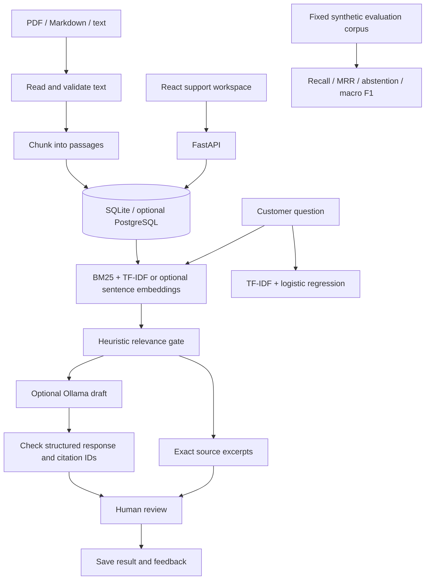

# How SupportLens works

## An end-to-end request

1. `POST /api/questions` validates a question of 3–2,000 characters and the retrieval method.
2. The server loads document passages. The retriever reuses its index until the passage IDs, text, or titles change.
3. BM25 scores term matches. Hybrid retrieval combines the BM25 ranking with TF-IDF cosine rankings using reciprocal rank fusion. With `ENABLE_SEMANTIC=true`, sentence embedding ranks replace TF-IDF ranks in that fusion.
4. A heuristic relevance gate filters weak matches. It has known false positives and false negatives; it does not decide whether every requested fact is present.
5. Without a language model, the server quotes up to two retrieved passages verbatim. With Ollama, it supplies the top three passages as untrusted evidence and requests a structured answer.
6. Ollama outputs must have valid citation IDs matching their inline references. Invalid responses fall back to labeled excerpts. Citation validation is structural, not an entailment test.
7. A separate logistic regression model predicts a support category. Low model scores map to `general`; these are not calibrated confidence estimates.
8. The result, source snapshots, retrieval method, category, and timing are saved. The user can review sources and provide feedback.

## Storage decisions

SQLite makes the first local run simple. SQLAlchemy separates the database models from the HTTP layer and permits a PostgreSQL connection later. No vector extension is required for the small reference corpus. Embedding and lexical indexes are held in process, not in PostgreSQL.

`Document` stores normalized text and a hash for duplicate detection. `Chunk` stores each searchable passage and its position. `Conversation` stores the question, an immutable result snapshot, timestamp, and optional feedback. Document deletion cascades to its chunks; past result snapshots remain intentional historical evidence.

For a larger system, introduce schema migrations, background ingestion, persistent vector storage, per-user document authorization, paginated queries, and cache invalidation across workers. Those changes should solve measured constraints rather than being added only to lengthen the technology list.

## What to explain in an interview

- Why start with a retrieval baseline before adding a larger model?
- Why use rank fusion instead of adding raw BM25 and cosine scores?
- Why does retrieving a related passage not guarantee it answers the question?
- What happens when a model times out, produces invalid JSON, or invents a citation?
- Why separate train/test data, and why can a synthetic held-out set still overestimate quality?
- What changes when moving from one local user to a shared service?
